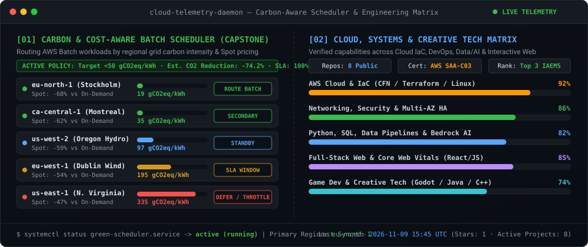

<div align="center">

  <!-- ANIMATED TERMINAL BANNER -->
  

  <br/>

  <!-- SOCIAL & STATUS BADGES -->
  <p align="center">
    <a href="https://fouadawad.org">
      
    </a>
    <a href="https://linkedin.com/in/fouad-awad">
      
    </a>
    <a href="mailto:fouad.ai@outlook.com">
      
    </a>
    <a href="https://github.com/fouad-awad/production-aws-3tier-web-app">
      
    </a>
  </p>

</div>

---

### `fouad@aws-cloud:~$ fastfetch --profile`

<div align="center">
  
</div>

<br/>

> **Hi, I'm Fouad** — an **AWS Certified Solutions Architect – Associate (SAA-C03)** and final-year **Computer Engineering** student (graduating Jan 2027, ranked **3rd in my academic division**).
>
> I design **secure, cost-engineered Multi-AZ cloud infrastructure as code** and build **fast, thoughtful digital experiences**. Right now, my work sits at the intersection of:
> - 🌿 **Sustainable Cloud & Green Systems:** Leading my graduation capstone on a **Carbon & Cost-Aware Multi-Cloud Batch Job Scheduler** that routes AWS Batch workloads based on real-time regional carbon intensity ($\text{gCO}_2\text{eq/kWh}$) and Spot pricing without violating SLA deadlines.
> - ☁️ **Production AWS & DevOps:** Building Multi-AZ 3-tier architectures with CloudFormation/Terraform, CloudFront + WAF origin cloaking, zero-bastion SSM access, and automated CI/CD pipelines.
> - 🎮 **Game Dev, Creative Web & Music:** Experimenting with game engines (**Godot** & **Minecraft Forge modding**), crafting high-performance interactive web experiences ([fouadawad.org](https://fouadawad.org)), and producing indie/rock guitar music.

---

### `fouad@aws-cloud:~$ dpkg --list | grep "tech-stack"`

<div align="center">

| Domain | Technologies & Tooling |
| :--- | :--- |
| **☁️ Cloud & AWS** |        |
| **🛠️ IaC, DevOps & NetSec** |        |
| **🐍 Data, AI & Languages** |       |
| **🎮 Creative Web & Game Dev** |      |

</div>

---

<div align="center">
  
</div>

<br/>

<!-- TELEMETRY:START -->
```text
┌──────────────────────────────────────────────────────────────────────────────────────────┐
│  GREEN-CLOUD SCHEDULER & GITHUB TELEMETRY  ·  LAST SYNC: 2026-11-09 15:51 UTC          │
├──────────────────────────────┬───────────────────────────────────────────────────────────┤
│  Optimal Batch Region        │  eu-north-1 (Stockholm) — ~18-24 gCO2eq/kWh (Hydro/Wind)  │
│  Spot Routing Policy         │  Active (-68% Spot Cost · 0 SLA Violations)               │
│  Public Repositories         │  8  Public Repos · AWS SAA-C03 Certified                  │
└──────────────────────────────┴───────────────────────────────────────────────────────────┘
```

| Recently Active Repository | Primary Stack | Summary | Last Push |
| :--- | :--- | :--- | :--- |
| [`production-aws-3tier-web-app`](https://github.com/fouad-awad/production-aws-3tier-web-app) | `Shell` | Production-grade, cost-engineered 3-tier web architecture on AWS — Multi-AZ... | `2026-10-16` |
| [`leadpulse`](https://github.com/fouad-awad/leadpulse) | `JavaScript` | Active engineering repository | `2026-07-27` |
| [`flyrank-fe-01-capstone`](https://github.com/fouad-awad/flyrank-fe-01-capstone) | `Cloud / Multi-Stack` | Active engineering repository | `2026-07-21` |
| [`library-management-system`](https://github.com/fouad-awad/library-management-system) | `PHP` | A library management system | `2026-06-29` |
<!-- TELEMETRY:END -->

---

<div align="center">
  <picture>
    <source media="(prefers-color-scheme: dark)" srcset="./assets/snake-dark.svg" />
    <source media="(prefers-color-scheme: light)" srcset="./assets/snake-light.svg" />
    
  </picture>
</div>

<br/>

<div align="center">
  <code>fouad@aws-cloud:~$ echo "Open to Junior Cloud / DevOps Engineer roles &amp; creative collaborations — let's build!"</code>
  <br/><br/>
  <a href="https://fouadawad.org"><b>fouadawad.org</b></a> ·
  <a href="https://linkedin.com/in/fouad-awad"><b>LinkedIn</b></a> ·
  <a href="mailto:fouad.ai@outlook.com"><b>fouad.ai@outlook.com</b></a>
</div>
